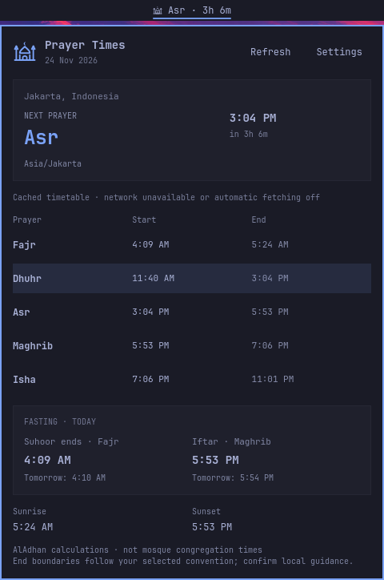
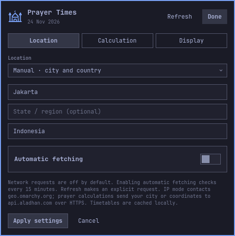
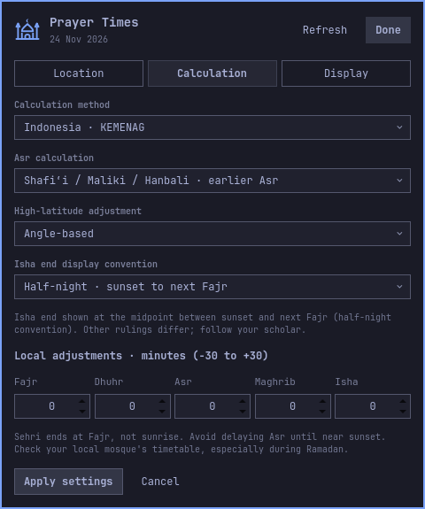

# Prayer Times for Omarchy

See how long until the next prayer without leaving the Omarchy bar. Open the widget for all five daily prayer windows, today's and tomorrow's suhoor and iftar times, and today's sunrise and sunset.

[Install](#install) · [Settings](#settings) · [Privacy](#privacy-and-reliability) · [Development](#development)

## Screenshots



| Location settings | Calculation settings |
| --- | --- |
|  |  |

*Captured in Omarchy's Quattro shell using sample timings for Jakarta. The widget follows your shell theme; these example times are not a live timetable.*

## Install

**Requires:** Omarchy 4.5 with the Quattro bar, Python 3.11+, and system timezone data (`tzdata`). No pip packages, API key, admin permissions, or changes to packaged Omarchy files are needed.

Review the source before enabling the plugin. Omarchy plugins run with your user permissions, not in a sandbox. Follow Omarchy's confirmation and placement prompts:

```sh
omarchy plugin add https://github.com/smmmsmo/omarchy-prayer-times.git --enable
```

1. Click the mosque icon and open **Settings**.
2. Pick a location. **Manual · city and country** skips IP geolocation and doesn't require exact coordinates. A state or region is optional.
3. Choose **Apply settings**, then **Refresh** to fetch the timetable. **Automatic fetching** is off by default.

**Shortcuts:** Right-click for Settings, middle-click to refresh, or run `omarchy bar move mo.prayer --section right` to move it to the right side of the bar.

## Settings

| Tab | What you can change |
| --- | --- |
| **Location** | Approximate IP location, manual city and country, or exact decimal coordinates with an optional label. |
| **Calculation** | AlAdhan's regional recommendation or one of 23 named methods, including Karachi, ISNA, MWL, Umm al-Qura, Moonsighting Committee, Tehran, and Jaʿfari. Choose Standard or Hanafi Asr, one of four high-latitude options, and the twilight convention for the Moonsighting Committee method. |
| **Display** | 12- or 24-hour time and automatic fetching. English, Bengali, and Arabic text and number formatting follow Omarchy's language setting live; unsupported languages use English text. |

The **Calculation** tab also controls the displayed Isha end: the midpoint from sunset to next Fajr, or next Fajr as an outer limit. Per-prayer adjustments range from −30 to +30 minutes; use them only to match a trusted local timetable.

### Reading the timetable

- The date is shown as `DD MMM YYYY`. The date, daylight saving time, and midnight rollover follow the selected location, not your computer's timezone.
- Fajr is the suhoor cutoff, not sunrise. Maghrib is the iftar time and is shown separately from astronomical sunset. Missing events, including polar-day or polar-night gaps, appear as `—`.
- These are **calculated windows, not mosque congregation times or religious rulings**. Confirm the timetable and the end boundaries with a local mosque or prayer authority, especially during Ramadan.

## Privacy and reliability

No analytics, telemetry, accounts, separate background service, API key, or GPS access. A fresh install makes no network requests until you choose **Refresh** or turn on **Automatic fetching**.

| HTTPS destination | When contacted | What it receives |
| --- | --- | --- |
| `geo.omarchy.org` | Only for approximate IP location | Request IP, used to look up an approximate location. |
| `api.aladhan.com` | When fetching a timetable | Request IP, selected city/region/country or coordinates, and calculation settings. Approximate IP coordinates are rounded first. The optional location label and local offsets are not sent. |

- **Refresh behavior:** With automatic fetching on, the widget checks every 15 minutes and reuses cached schedules and approximate IP location when possible. The IP result is reused for up to an hour. Startup, applying settings, and local midnight can also trigger checks. Manual **Refresh** bypasses the timetable cache for today and tomorrow. With automatic fetching off, background checks use only the cache.
- **Local settings:** **Apply settings** saves the widget's preferences to Omarchy's local `shell.json`. The helper receives settings via standard input, not command-line arguments. Review the file before sharing it.
- **Offline cache:** `${XDG_CACHE_HOME:-$HOME/.cache}/omarchy/namaz/v2` stores validated times, timezone, and method, plus approximate location in IP mode only. It omits raw provider metadata and does not duplicate manually entered locations. Files are written privately and atomically. Entries older than seven days are ignored and pruned during online refresh. An extra day is prefetched for offline rollover. Cached results are labeled and must match the location, settings, and date.

## Update or remove

```sh
omarchy plugin update mo.prayer  # Update a Git-managed install
omarchy plugin disable mo.prayer # Hide without uninstalling
omarchy plugin remove mo.prayer  # Uninstall through Omarchy's confirmation prompt
```

**Migrating from `mo.namaz` (1.1.2 or earlier):** Omarchy treats `mo.prayer` as a separate plugin. Note your settings, remove the old copy with `omarchy plugin remove mo.namaz`, then [install `mo.prayer`](#install) and reapply your settings. `omarchy plugin update mo.namaz` does not switch IDs.

Uninstalling leaves the timetable cache alone. To delete it too, review and confirm removal of this plugin's cache directory:

```sh
rm -ri -- "${XDG_CACHE_HOME:-$HOME/.cache}/omarchy/namaz"
```

## Development

```sh
./test/all
```

The suite runs without network access and uses Python, Node.js, and `tzdata`. It also validates the manifest when the Omarchy CLI is available.

- [AGENTS.md](AGENTS.md) — repository map, development guardrails, and checks for coding agents.
- [Development guide](docs/development.md) — data flow, manual smoke tests, and screenshot guidance.
- [Submission notes](SUBMISSION.md) — Omarchy marketplace and upstream handoff.
- [Security policy](SECURITY.md) · [MIT license](LICENSE)
